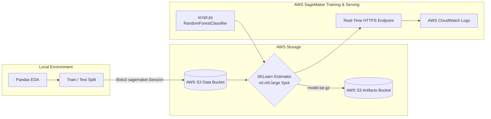

# Mobile Price Classification using AWS SageMaker & Scikit-Learn

This project demonstrates an end-to-end Machine Learning pipeline built on AWS SageMaker using custom Scikit-Learn scripts.

## Project Architecture

### Data Flow Breakdown
1. **Data Ingestion & S3 Storage**: Processed dataset split and uploaded to AWS S3 using `boto3` and `sagemaker.Session`.
2. **Model Training**: Trained a `RandomForestClassifier` on AWS compute instances (`ml.m5.large` Spot) via SageMaker `SKLearn` Estimator executing a custom `script.py`.
3. **Model Artifacts**: Exported `model.joblib` compressed to `model.tar.gz` and saved to S3 for reproducibility.
4. **Endpoint Deployment & Observability**: Deployed a real-time HTTPS SageMaker endpoint for live predictions and inference, with traffic and metrics tracked continuously via AWS CloudWatch logs.

## Tech Stack
- **Cloud**: AWS SageMaker, S3, IAM, CloudWatch
- **Languages & Frameworks**: Python 3.12, Scikit-Learn, Pandas, Boto3
- **Dev Environment**: VS Code / GitHub Codespaces

## Results
- **Test Accuracy**: ~88% on held-out test dataset across 4 mobile price tiers.
